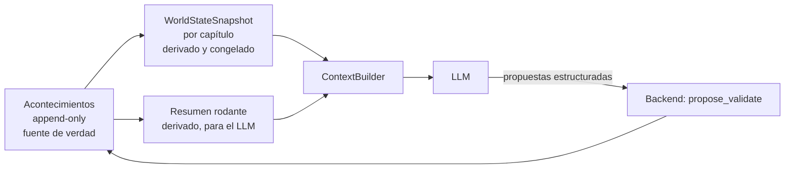

# STATE_MODEL.md — Modelo de estado del mundo

> Documento consolidado de la arquitectura objetivo H3.
> Etiquetas: **[EXISTE]** implementado y verificado · **[OBJETIVO]** decisión aprobada,
> no implementado · **[PENDIENTE]** decisión abierta.
>
> H3 no ha sido ejecutado: ninguna tabla, servicio o flujo descrito como [OBJETIVO]
> existe en el código actual.

---

## 1. Decisión aprobada: `propose_validate`

El LLM **propone** acontecimientos estructurados; el backend **valida** las propuestas
antes de persistirlas. PostgreSQL es la fuente de verdad.

- El LLM nunca escribe en la base de datos.
- El LLM nunca lee la base de datos directamente: `ContextBuilder` construye el contexto
  que recibe.
- La validación backend es la única puerta de entrada al estado del mundo. Una propuesta
  inválida se rechaza (contrato de errores existente [EXISTE]: `LLMResponseError` para
  salida no conforme; validaciones semánticas de dominio [OBJETIVO]).

Por qué este modelo:

- **Qué evita:** que el "recuerdo" de la serie dependa de la fidelidad del LLM o del
  contenido de un prompt. El estado vive en PostgreSQL, auditable y corregible.
- **Qué pasa si no se hace:** el universo diverge entre lo que el LLM cree que pasó y lo
  que pasó; las discontinuidades se vuelven indistinguibles e irrecuperables.

## 2. Los tres artefactos de estado (decisión aprobada)

### 2.1 Acontecimiento — *qué ha sucedido* [OBJETIVO]

Registro **append-only** de eventos del universo. Un acontecimiento no se edita ni se
borra: si algo queda mal, se registra un acontecimiento correctivo posterior.

Contenido propuesto (sujeto a la taxonomía [PENDIENTE]):

- identificación (serie, temporada, capítulo de origen)
- `type` — tipo de acontecimiento (taxonomía **[PENDIENTE]**, ver `ACTIONS_SCHEMA.json`)
- `description` — qué ocurrió, en lenguaje natural estructurado
- personajes y ubicación implicados — mecanismo de referencia **[PENDIENTE]**:
  por ID de entidad o por nombre
- origen de la propuesta: que fue generada por el LLM en el desarrollo del capítulo N,
  validada por el backend (trazabilidad de la validación)

Garantías [OBJETIVO]:

1. Append-only: sin UPDATE ni DELETE sobre acontecimientos narrativos.
2. Toda inserción pasa por `WorldStateService` tras validación (`propose_validate`).
3. Todo acontecimiento es rastreable al capítulo y a la llamada LLM que lo propuso.

### 2.2 WorldStateSnapshot — *cómo está el mundo* [OBJETIVO]

Foto del estado del universo **congelada al cierre de cada capítulo**:

- dónde está cada personaje
- objetos en juego
- estado de las relaciones
- tensión/estructura narrativa en curso

Es una vista derivada de los acontecimientos + el desarrollo del capítulo. Se persiste
(imagen congelada, inmutable una vez cerrado el capítulo).

**[PENDIENTE: mecanismo de producción]** — que el snapshot sea una "vista derivada"
describe *qué es*, no *cómo se produce*. Quién lo calcula (derivación automática de
código a partir de los acontecimientos, o propuesta del LLM validada por el backend) es
una decisión abierta: partes del snapshot (p. ej. la "tensión narrativa en curso") no
son derivables mecánicamente de un log de eventos. Pendiente también de decidir en qué
forma se almacena (tabla propia vs. estructura dentro del capítulo).

Por qué congelarlo: las consultas de continuidad del capítulo N+1 leen el snapshot del
capítulo N; si fuera mutable, el contexto de cada capítulo dependería del momento de la
lectura (no reproducible).

### 2.3 Resumen rodante — *contexto narrativo compacto para el LLM* [OBJETIVO]

Resumen acumulado de la historia anterior, mantenido al cerrar cada capítulo.

**[PENDIENTE: mecanismo de producción]** — que se "mantenga al cerrar cada capítulo"
describe el momento, no el procedimiento: si el resumen lo genera el LLM (con
validación backend) o se deriva mecánicamente es una decisión abierta, al igual que su
forma de almacenamiento (tabla propia vs. atributo de la temporada — la lista de la
sección 5 lo menciona como tabla, lo cual es una propuesta de implementación, no una
decisión aprobada).

- Propósito: el contexto que recibe el LLM debe ser de **tamaño aproximadamente
  constante**, no creciente con el número de capítulos.
- Sustituye al mecanismo actual [EXISTE] (los últimos 3 episodios concatenados como
  texto), que degrada: no cubre la serie completa y crece linealmente si se amplía.
- Es la única pieza de los tres artefactos cuya audiencia es exclusivamente el LLM.

### 2.4 Relación entre los tres

- El **log de acontecimientos** responde "¿qué pasó?" (auditable, humano).
- El **snapshot** responde "¿cómo está el mundo?" (consulta, continuidad).
- El **resumen rodante** responde "¿qué debe recordar el LLM?" (compacto, solo LLM).
- Si solo existiera el log, el prompt crecería sin límite; si solo existieran snapshots,
  se perdería la trazabilidad de por qué el mundo está como está. Por eso los tres.

## 3. Personajes, ubicaciones y relaciones [OBJETIVO]

- **Personaje:** identidad narrativa (nombre, descripción en la biblia) **separada** del
  perfil visual (apariencia para prompts). Preparado para referencias visuales y LoRAs
  con versiones; **sin** implementar entrenamiento ni mecanismos avanzados [PENDIENTE:
  campos concretos de `visual_refs` y estrategia de consistencia].
- **Ubicación:** descripción narrativa + descripción visual estable para prompts.
- **Relación:** vínculo entre dos personajes con tipo, estado e historia acumulada.
- Los beats y escenas *referencian* estos elementos; no los redefinen. La descripción
  canónica vive una sola vez (evita el estado actual, donde el mismo personaje se
  describe en cada `visual_metadata` con riesgo de contradicción).

## 4. Estado actual del modelo (para contraste) [EXISTE]

| Aspecto | Hoy |
|---|---|
| Persistencia de narrativa | `narrative(episode_number, payload JSONB)` — 20 episodios reales |
| Acciones | `detected_actions: list[str]` — texto plano, sin estructura, sin validación semántica |
| Estado del mundo | No existe como concepto |
| Continuidad | Texto de los últimos 3 episodios dentro del prompt (`ScriptService.get_prompt_context`) |
| Validación de salida LLM | Solo schema (`LlmResponse`), sin validación semántica de dominio |
| Acceso del LLM a BD | No existe (coherente con el objetivo) |

## 5. Qué deberá construirse (pendiente de implementación)

1. Tablas y repositorios de Personaje, Ubicación, Relación, Acontecimiento,
   WorldStateSnapshot y Resumen rodante [OBJETIVO]. Nota: la forma de almacenamiento
   del snapshot y del resumen rodante (tabla propia vs. estructura interna) es una
   **propuesta de implementación**, no una decisión aprobada — ver las anotaciones
   [PENDIENTE] de las secciones 2.2 y 2.3.
2. `WorldStateService` con la lógica `propose_validate` [OBJETIVO].
3. `ContextBuilder` estructurado (hoy hay una versión de texto dentro de `ScriptService`)
   [OBJETIVO].
4. Contrato del LLM según `ACTIONS_SCHEMA.json` + validadores backend [OBJETIVO].
5. Datos históricos (decisión aprobada): los 20 episodios existentes se conservan como
   histórico en `narrative`, sin migrar al nuevo esquema; la nueva estructura arranca
   desde cero.
6. Taxonomía de tipos de acontecimiento y mecanismo de referencia a personajes
   [PENDIENTE].

## 6. Garantías transversales (resumen)

1. PostgreSQL es la única fuente de verdad del estado.
2. El estado del mundo solo entra validada (`propose_validate`).
3. Los acontecimientos son inmutables (append-only).
4. Los snapshots son congelados por capítulo.
5. El contexto del LLM es ensamblado por código, registrado y de tamaño acotado.
6. Todo cambio de estado es trazable a un capítulo y a una llamada LLM.
