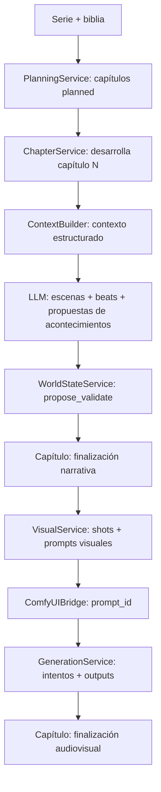

# SYSTEM_SPEC.md — Especificación del sistema ai-content

> Documento consolidado de la arquitectura objetivo H3.
> Convención de etiquetas usada en todo el documento:
>
> - **[EXISTE]** — implementado y verificado en el código actual.
> - **[OBJETIVO]** — decisión de diseño aprobada para H3. **No implementado.**
> - **[PENDIENTE]** — decisión abierta, ambigua o con información insuficiente.
>
> Nada etiquetado como [OBJETIVO] o [PENDIENTE] debe asumirse como funcionalidad
> existente. H3 **no ha sido ejecutado**.

---

## 1. Qué es el producto

Fábrica de contenido audiovisual basada en IA: el usuario crea una **serie**
estructurada (temporadas con límite de capítulos configurable), la app planifica la
temporada, desarrolla los capítulos individualmente manteniendo continuidad narrativa
mediante datos estructurados, y produce contenido visual (imágenes inicialmente) con
ComfyUI.

## 2. Estado actual ([EXISTE])

### 2.1 Pipeline funcional verificado E2E

```
POST /generate-script (topic)
  → ScriptService: contexto (últimos 3 episodios como texto) + prompt
  → OllamaProvider → LlmResponse (narrative, detected_actions: list[str], visual_metadata)
  → NarrativeRepository → tabla narrative (episode_number, payload JSONB)
  → ComfyUIBridge.submit_prompt → prompt_id
  → ComfyUI ejecuta el workflow → imagen en temp/ (no persistida)
```

### 2.2 Infraestructura de contratos

- **Errores tipados** [EXISTE]: jerarquía `AppError` en `app/core/exceptions.py`
  (`LLMProviderError` → Connection/Timeout/Response; `ComfyUIBridgeError` →
  Connection/Timeout/Response/Workflow; `NarrativeStateError`) + 8 exception handlers
  HTTP en `main.py` (503/504/502/422/500). Ver `docs/P0.1_LLM_ERROR_CONTRACT.md`.
- **Bridge ComfyUI** [EXISTE]: protocolo real `/prompt`, inyección en el nodo positivo,
  `submit_prompt(visual_metadata) -> prompt_id`, `node_errors` validados.
  Ver `docs/P0.2_COMFYUI_INTEGRATION.md`.
- **Migraciones** [EXISTE]: baseline `0001_baseline_narrative`, URL desde `.env`,
  credenciales fuera del repo. Ver `docs/P0.3_ALEMBIC_CREDENTIALS.md`.
- **Suite de tests** [EXISTE]: 31 tests (providers, bridge, handlers, baseline Alembic).

### 2.3 Limitaciones del estado actual (lo que motiva H3)

- Un solo nivel de estructura: el "episodio" es capítulo, escena, beat y shot a la vez.
- Continuidad confiada al texto del prompt (no escala con la serie).
- Sin personajes, ubicaciones ni estado del mundo estructurado.
- Sin planificación, sin estados de ciclo de vida, sin trazabilidad de generaciones.

## 3. Arquitectura objetivo ([OBJETIVO])

### 3.1 Tres planos (decisión aprobada)

1. **Estructura narrativa**: Serie → Temporada → Capítulo → Escena → Beat → Shot.
2. **Estado del mundo**: Personajes, Ubicaciones, Relaciones, Acontecimientos,
   WorldStateSnapshot, Resumen rodante. (Detalle en `STATE_MODEL.md`.)
3. **Producción audiovisual**: Shot → Generation (intentos) → outputs.

La unidad narrativa (Beat) y la unidad de producción (Shot) son diferentes; un Beat
puede tener cero, uno o varios Shots.

Aclaración sobre el **doble papel de Shot**: Shot es a la vez un nodo de la jerarquía
narrativa (plano 1, cuelga de un Beat) y el ancla de la producción audiovisual (plano 3,
de él cuelgan las `Generation`). No es una entidad duplicada: es una sola entidad con
dos roles, y los planos solo describen sus relaciones distintas.

Composición del plano 1: la **biblia** de la serie (tono, estilo, reglas del universo)
es un atributo de `Serie` (referencia en el flujo de §3.4: "Serie + biblia"); el límite
de capítulos configurable por serie es otro atributo de `Serie` — pendiente de decidir
si el valor efectivo por temporada puede sobrescribirse en `Temporada` [PENDIENTE
menor].

### 3.2 Servicios previstos (decisión aprobada)

| Servicio | Responsabilidad | Estado |
|---|---|---|
| `PlanningService` | outline de temporada (capítulos `planned`), límite configurable por serie, versionado de planificaciones | [OBJETIVO] |
| `ChapterService` | desarrollo individual del capítulo (escenas + beats) | [OBJETIVO] |
| `ContextBuilder` | ensambla el contexto que recibe el LLM (nunca BD cruda) | [OBJETIVO] — existe hoy solo como método interno de `ScriptService` |
| `WorldStateService` | valida y persiste acontecimientos (`propose_validate`), snapshots, resumen rodante | [OBJETIVO] |
| `VisualService` | de beat/shot a prompt visual → `submit_prompt` | [OBJETIVO] |
| `GenerationService` | poll `/history`, outputs, estados de intentos | [OBJETIVO] |

Regla aprobada: la lógica de negocio permanece independiente de FastAPI (los servicios
no importan el framework). [EXISTE] como principio en los servicios actuales.

### 3.3 Persistencia y LLM (decisión aprobada)

- PostgreSQL es la fuente de verdad. [EXISTE] como principio.
- El LLM no tiene acceso directo a la BD: el contexto lo construye `ContextBuilder`.
  [EXISTE] como principio; [OBJETIVO] el ensamblado estructurado (snapshot + resumen
  rodante + fichas de personajes).

### 3.4 Flujo objetivo



Los ciclos de finalización narrativa y audiovisual son **independientes** (decisión
`separate`): la generación de imágenes no determina el estado narrativo del capítulo.

## 4. Tabla de cobertura: actual vs. objetivo vs. pendiente

| Capacidad | Estado |
|---|---|
| Pipeline único episodio → imagen | [EXISTE] |
| Contrato de errores LLM/Comfy + handlers HTTP | [EXISTE] |
| `prompt_id` real + workflow inyectable | [EXISTE] |
| Migraciones reproducibles (baseline) | [EXISTE] |
| Suite de tests de contratos | [EXISTE] |
| Serie / Temporada / Capítulo / Escena / Beat / Shot | [OBJETIVO] |
| Planificación con estado `planned` y versionado | [OBJETIVO] — mecanismo de versionado [PENDIENTE] |
| Personajes / Ubicaciones / Relaciones / Acontecimientos / Snapshot / Resumen rodante | [OBJETIVO] |
| `propose_validate` (LLM propone, backend valida) | [OBJETIVO] — taxonomía de tipos [PENDIENTE] |
| Finalización narrativa y audiovisual separadas | [OBJETIVO] |
| `Generation` con intentos múltiples y trazabilidad | [OBJETIVO] |
| Salida de vídeo | [OBJETIVO] como estructura preparada; pipeline [PENDIENTE] |
| Referencias visuales / LoRA por personaje (sin entrenamiento) | [OBJETIVO] como campos preparados; mecanismo [PENDIENTE] |
| Datos históricos: los 20 episodios existentes se **conservan como histórico** en la tabla `narrative`, sin migrar al nuevo esquema; la nueva estructura arranca desde cero | [EXISTE como dato] / decisión aprobada |

## 5. Contradicciones actuales ↔ objetivo (a resolver durante H3)

1. El "episodio" actual mezcla capítulo/escena/beat/shot → descomponer en el esquema nuevo.
2. Continuidad por prompt-texto → sustituir por contexto estructurado de `ContextBuilder`.
3. `detected_actions: list[str]` → sustituir por acontecimientos estructurados
   (`propose_validate`, contrato en `ACTIONS_SCHEMA.json`).
4. Finalización acoplada: `generate_script` es una única **operación de aplicación** que
   coordina generación narrativa (LLM + persistencia) y envío audiovisual (ComfyUI) en
   la misma llamada HTTP; el diseño exige ciclos de finalización independientes. (Nota:
   no se afirma nada sobre transacciones de base de datos compartidas; el acoplamiento
   es orquestación a nivel de servicio.)
5. Dispatch fire-and-forget a ComfyUI → ciclos de generación con estados e intentos.

## 6. Documentación relacionada

- `AGENTS.md` — reglas de trabajo del asistente.
- `docs/P0.1_LLM_ERROR_CONTRACT.md` — contrato de errores LLM.
- `docs/P0.2_COMFYUI_INTEGRATION.md` — integración ComfyUI.
- `docs/P0.3_ALEMBIC_CREDENTIALS.md` — migraciones y credenciales.
- `STATE_MODEL.md` — modelo de estado del mundo.
- `ACTIONS_SCHEMA.json` — contrato de propuestas del LLM.
- `ENGINE_RULES.md` — reglas del motor (ciclos, estados, generaciones).
