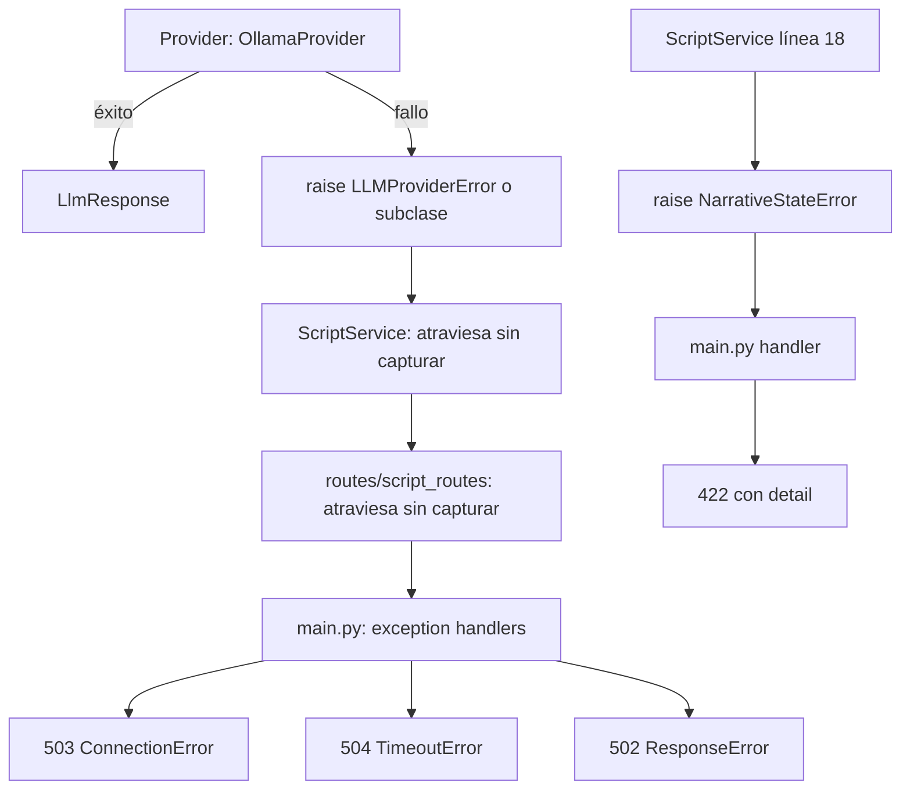

# P0.1 — Contrato de errores entre proveedores LLM y ScriptService

> Documento técnico del bloque P0.1 del proyecto **ai-content**.
> Estado del bloque: **implementado, verificado y validado en vivo** (con Ollama real).

---

## 1. Problema original

`OllamaProvider.generate_script` tenía **8 caminos de salida con 3 convenciones distintas**:

| Camino | Línea original | Salida |
|---|---|---|
| Éxito | `ollama_provider.py:33` | `LlmResponse` |
| Status ≠ 200, JSON inválido, falta `"message"`, ConnectError, Timeout ×2, Exception genérica | `20, 25, 28, 41-47` | `str` descriptivo del error |
| Fallo de Pydantic al validar la salida del LLM | `38` | `raise` de una `ValidationError` cruda |

Consecuencias demostradas:

- `script_service.py:27` ejecutaba `parsed.model_dump()` sin verificar el tipo: si el
  provider devolvía un string de error, la petición moría con
  `AttributeError: 'str' object has no attribute 'model_dump'` → **500 genérico** y el
  mensaje diagnóstico (timeout, conexión, etc.) se perdía por completo.
- La inconsistencia era interna incluso al provider: un mismo método mezclaba
  retorno-válido, retorno-de-error-como-string y excepción cruda.
- `except Exception` (línea 46) capturaba también bugs propios, disfrazándolos como
  "Error inesperado en el proveedor Ollama".
- El `ValueError` de `script_service.py:18` (primer episodio sin tema) era otro error de
  dominio sin traducción HTTP (500 en vez de 422).
- El contrato declarado en `BaseAIProvider` (`-> LlmResponse`) solo describía el éxito:
  una interfaz que no especifica el error no es un contrato completo.

Causa raíz (diseño, no síntoma): no se definió **dónde vive la responsabilidad del
error**; los errores se gestionaron reactivamente en el punto de origen ("evitar que
crashee ahora") en lugar de propagarse para que cada capa los tradujera a su idioma.

## 2. Arquitectura

```
routes (HTTP)  →  services (negocio)  →  providers (infraestructura)
       ↑                  ↑
main.py: exception handlers   app/core/exceptions.py (jerarquía de dominio)
```

- **`app/core/exceptions.py`**: vocabulario de errores de dominio, compartido por todas
  las capas internas. Se creó como paquete `core/` porque P0.2 (ComfyUI) y futuros
  errores colgan del mismo árbol.
- **`BaseAIProvider`** (interfaz): documenta el contrato completo en su docstring.
- **`OllamaProvider` / `OpenAIProvider`**: solo lanzan excepciones del dominio.
- **`ScriptService`**: no captura lo que no puede manejar; el contrato restaurado le
  permite confiar en el tipo de retorno (`parsed.model_dump()` es seguro de nuevo).
- **`main.py`**: único lugar que habla HTTP; registra los handlers.

## 3. Contratos de datos y errores

**Éxito:** `generate_script(prompt: str) -> LlmResponse`
(`narrative: str`, `detected_actions: list[str]`, `visual_metadata: VisualMetadataContext`).

**Fallo:** siempre una subclase de `LLMProviderError ⊂ AppError`:

| Excepción | Condición | HTTP |
|---|---|---|
| `LLMConnectionError` | Ollama inalcanzable (`httpx.ConnectError`) u otro fallo de transporte | 503 |
| `LLMTimeoutError` | `httpx.TimeoutException` (hermana de la anterior, no subclase) | 504 |
| `LLMResponseError` | status ≠ 200, cuerpo no JSON, sin `message`, o salida del LLM que no cumple `LlmResponse` | 502 |
| `NarrativeStateError` | Primer episodio (`episode_number == 0`) sin `topic` | 422 |

Reglas del contrato:

1. Un único mecanismo: retornar o lanzar, nunca mezclar.
2. `LLMResponseError` puede llevar `raw_detail` (salida cruda del LLM, **recortada a
   500 caracteres** en el constructor) **exclusivamente para logging interno**; jamás
   viaja en la respuesta HTTP (la regla está documentada en el docstring de la clase).
3. `except httpx.TimeoutException` se declara **antes** que `except httpx.HTTPError`
   (subclase → superclase); el `except Exception` indiscriminado fue **eliminado**.
4. Las causas se encadenan con `raise ... from e` (el traceback conserva el origen).
5. `OpenAIProvider` es un stub coherente: importa correctamente (`app.services...`),
   es `async`, tipa la firma y lanza `NotImplementedError` (error de programación).

## 4. Gestión de errores (propagación)



Regla instalada: **el provider lanza en el idioma del dominio; el servicio no traduce lo
que no maneja; solo `main.py` habla HTTP.**

## 5. Archivos modificados

| Archivo | Cambio |
|---|---|
| `app/core/__init__.py`, `app/core/exceptions.py` | **Nuevos**: jerarquía `AppError` completa (incluye lo añadido luego en P0.2) |
| `app/services/ai/providers/ollama_provider.py` | Reescrito: 8 caminos → excepciones tipadas; `except Exception` eliminado; logging de módulo; tipado `-> LlmResponse` |
| `app/services/ai/base_ai.py` | Docstring del contrato + tipado |
| `app/services/ai/providers/openai_provider.py` | Import corregido, método `async`, `NotImplementedError` |
| `app/services/ai/script_service.py` | `ValueError` → `NarrativeStateError` (2 líneas) |
| `app/main.py` | 4 handlers (503/504/502/422) + corrección colateral: la ruta `/` nunca estaba registrada (`app.get("/")` sin decorador `@`) |

## 6. Pruebas realizadas

### Unitarias / estáticas (sin efectos secundarios)

| # | Prueba | Resultado |
|---|---|---|
| 1 | Compilación de los 7 archivos | ✅ |
| 2 | Jerarquía: timeout/conexión hermanas, todas ⊂ `AppError` | ✅ |
| 3 | `raw_detail` recortado exactamente a 500 chars (probado con string de 2000) | ✅ |
| 4 | Handlers vía `dependency_overrides` (stub): 503/504/502/422 con cuerpo `{"detail": str(exc)}` | ✅ los 4 |
| 5 | Import de `OpenIAProvider` (antes crasheaba) + firma `(prompt: str) -> LlmResponse` | ✅ |
| 6 | Ruta `/` registrada en `app.routes` | ✅ |

### Integración (con Ollama y PostgreSQL reales)

| # | Prueba | Resultado |
|---|---|---|
| 7 | Camino feliz: episodio generado, validado, persistido (verificado en vivo durante P0.2) | ✅ sin regresión |
| 8 | Causa encadenada en tracebacks (`from e`) | ✅ observado en logs |

### E2E

No aplicable como bloque separado: la validación en vivo de este contrato quedó cubierta
por la E2E de P0.2 (los caminos de error del LLM comparten la misma ruta HTTP).

## 7. Limitaciones pendientes

1. **Sin suite de tests formal**: no hay pytest instalado en `venv311`; todas las
   verificaciones fueron scripts manuales/puntuales. La suite con `httpx.MockTransport`
   (status 500, JSON inválido, schema inválido, timeout → excepción exacta) está
   diseñada pero no implementada.
2. **`timeout=500` hardcoded** en `ollama_provider.py`: un `LLMTimeoutError` tarda
   realmente hasta 500 s en producirse; es configuración pendiente (P1).
3. **URLs y `MODEL_NAME` hardcoded** en el provider (P1: capa de configuración).
4. **Ruta sin `response_model`**: la respuesta sigue siendo `{"msg": ...}` sin tipado de
   salida (el bloque de trazabilidad la retocará).
5. **`OpenAIProvider` sigue siendo stub** (raise `NotImplementedError`): coherente, pero
   sin implementación real.
6. **`prueba_llm_parser.py`** sigue en el paquete `schemas/parsers/` con su schema
   divergente (limpieza pendiente, P1).

## 8. Próxima validación

1. Instalar pytest (requiere autorización de dependencias).
2. `tests/test_ollama_provider.py` con `httpx.MockTransport`: 4 escenarios de fallo →
   4 excepciones exactas + mensajes; éxito → `LlmResponse`.
3. `tests/test_error_handlers.py` con `TestClient`: 502/503/504/422 + ausencia de
   `raw_detail` en el cuerpo.
4. Test de contrato: capturar solo `LLMProviderError` cubre los tres casos de fallo.
