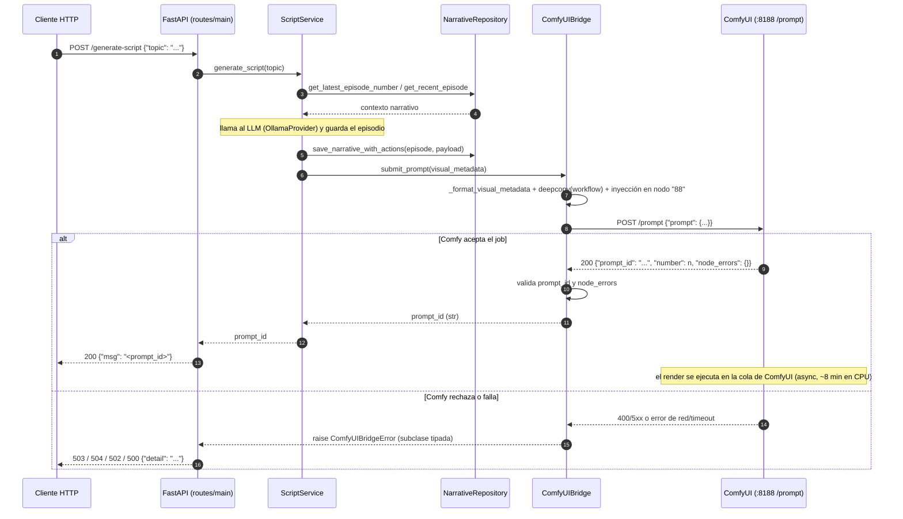

# P0.2 — Integración ComfyUIBridge ↔ ComfyUI

> Documento técnico del bloque P0.2 del proyecto **ai-content**.
> Estado del bloque: **implementado y verificado estáticamente**.
> El camino de éxito con un `prompt_id` real **queda pendiente de validación E2E** (sección 7).

---

## 1. Problema original

El `ComfyUIBridge` original (`backend/app/services/ai/visual_bridge.py`) tenía tres fallos
demostrados durante la auditoría:

1. **Protocolo incorrecto (H1).** El bridge parseaba la respuesta de `POST /prompt` con el
   formato de chat de Ollama (`{"message": {"content": ...}}`). La respuesta real de ComfyUI
   es `{"prompt_id": ..., "number": ..., "node_errors": ...}` (verificado en el código
   fuente del propio servidor, `temp_comfy/server.py:1232`). Al no existir la clave
   `"message"`, la comprobación `if "message" not in data` era siempre verdadera:
   **el bridge devolvía un string de error en el 100 % de los casos, incluso cuando ComfyUI
   encolaba y ejecutaba el trabajo correctamente.**
   Evidencia en vivo: la validación E2E previa a este bloque aceptó el job
   `05da3d7d-5d77-4150-9d0f-91544c6f14fa` y el endpoint respondió
   `200 {"msg": "Error: Respuesta de Comfy {...}"}`.
2. **Punto de inyección erróneo (H2).** El texto narrativo se inyectaba en el nodo `"77"`,
   que en el workflow actual es el encoder **negativo** del `KSampler`
   (`82.negative -> ["77", 0]`). La narrativa generada por el LLM se usaba para decir al
   modelo qué *evitar*, mientras que el prompt positivo (nodo `"88"`) contenía texto
   hardcodeado. La imagen generada no reflejaba la narrativa.
3. **Contrato de errores roto.** Todos los fallos se retornaban como strings
   (`return "Error: ..."`) que `ScriptService` trataba como si fueran resultados válidos y
   la ruta HTTP exponía crudos en `{"msg": ...}` con código 200. Además existía un riesgo
   de cuerpo HTTP vacío: strings con caracteres no codificables a UTF-8 hacían que
   `JSONResponse` lanzara `UnicodeEncodeError` después de enviar las cabeceras
   (mecanismo reproducido en aislamiento durante P0.1).

## 2. Arquitectura

```
routes/script_routes.py      (capa HTTP; sin lógica de errores)
        |
dependencies.py             (construye OllamaProvider + NarrativeRepository + ComfyUIBridge)
        |
services/ai/script_service.py   (orquestador de negocio)
        |                       delega el envío visual
        v
services/ai/visual_bridge.py    (adaptador de infraestructura de ComfyUI)
        |  HTTP POST /prompt (httpx)
        v
ComfyUI (127.0.0.1:8188, temp_comfy, API JSON)
```

Responsabilidades:

- **`ComfyUIBridge`** (adaptador): carga y valida el workflow JSON
  (`app/services/comfy/workflows/prueba_1.json`), formatea el `visual_metadata` del LLM a
  una línea de texto, inyecta ese texto en el nodo prompt positivo, construye el payload
  de la API de ComfyUI y lo envía por HTTP. Conoce el protocolo de ComfyUI; no conoce
  HTTP-para-cliente ni la base de datos.
- **`ScriptService`** (orquestador): tras guardar el episodio narrativo en PostgreSQL,
  extrae `payload["visual_metadata"]` y llama a `visual_bridge.submit_prompt(...)`.
  No sabe que existe ComfyUI ni HTTP: solo conoce el contrato del bridge
  (retorna `prompt_id` o lanza `ComfyUIBridgeError`).
- **`main.py`** (capa de transporte): único lugar donde las excepciones de dominio se
  traducen a respuestas HTTP mediante *exception handlers* de FastAPI.

La ruta del workflow se resuelve relativa a `__file__`
(`Path(__file__).resolve().parents[1] / "comfy" / "workflows" / "prueba_1.json"`),
no respecto al directorio de arranque de uvicorn.

## 3. Contrato de comunicación

### 3.1 Petición a ComfyUI

`POST http://127.0.0.1:8188/prompt` con cuerpo JSON:

```json
{
  "prompt": {
    "<node_id>": {
      "inputs": { "...": "..." },
      "class_type": "NombreDeNodo",
      "_meta": { "title": "..." }
    }
  }
}
```

El bridge parte de la plantilla `prueba_1.json` (workflow de 10 nodos: `CLIPLoader`,
`UnetLoaderGGUF` (SD1.5 GGUF Q4_0), `LoraLoader`, dos `CLIPTextEncode`, `KSampler`,
`VAELoader`, `EmptyLatentImage`, `VAEDecode`, `PreviewImage`), hace una copia profunda
(`copy.deepcopy`) y sustituye **solo** el campo `inputs.text` del nodo
`PROMPT_NODE_ID = "88"` (encoder positivo del KSampler) con el texto formateado:

```
character, visual_action, expression_gaze, props_hand?, environment, camera_lighting
```

(los valores `None` se omiten; unión por `", "`).

El nodo `"77"` (encoder negativo) conserva el texto fijo del workflow: el bridge no lo
modifica.

### 3.2 Respuesta esperada en éxito

HTTP 200 con cuerpo (formato verificado en `temp_comfy/server.py:1232`):

```json
{
  "prompt_id": "uuid-v4",
  "number": 0,
  "node_errors": {}
}
```

Extracción:

- `prompt_id` debe ser un `str` no vacío; en caso contrario → `ComfyUIResponseError`.
- `node_errors` debe estar vacío (`{}`); si no → `ComfyUIResponseError`.
  Justificación: ComfyUI **encola el job aunque haya nodos con errores**; aceptar el
  `prompt_id` con `node_errors` no vacío dejaría descubrir el fallo minutos después
  (en CPU, un render tarda ~8 minutos).

### 3.3 Retorno del bridge

`submit_prompt(visual_metadata: dict) -> str` retorna el `prompt_id` recibido.
Ese valor llega a `ScriptService.generate_script` y, actualmente, la ruta lo expone como
`{"msg": "<prompt_id>"}` (sin `response_model`; limitación conocida, fuera de este bloque).

## 4. Gestión de errores

Jerarquía (en `app/core/exceptions.py`, todas ⊂ `AppError`):

| Excepción | Condición que la dispara | HTTP (handler en `main.py`) |
|---|---|---|
| `ComfyUIConnectionError` | ComfyUI no responde (`httpx.ConnectError`) u otro fallo de transporte (`httpx.HTTPError`) | 503 |
| `ComfyUITimeoutError` | `httpx.TimeoutException` (timeout de 30 s en el POST) | 504 |
| `ComfyUIResponseError` | status ≠ 200, cuerpo no JSON, `prompt_id` ausente/inválido, o `node_errors` no vacío | 502 |
| `ComfyUIWorkflowError` | Workflow inexistente, JSON inválido, o nodo `"88"` ausente/no-`CLIPTextEncode` (se lanza al instanciar el bridge) | 500 |

Reglas del contrato (idénticas a las fijadas en P0.1):

- `submit_prompt` **solo** tiene dos salidas: retorna `str` (`prompt_id`) o lanza una
  subclase de `ComfyUIBridgeError`. Nunca retorna valores de error.
- Las excepciones se encadenan con `raise ... from e` para preservar la causa original.
- Los cuerpos de error externos se recortan a 200 caracteres antes de incluirse en el
  mensaje (nunca se envían crudos al cliente; es la mitigación del riesgo de cuerpo vacío
  por caracteres no codificables).
- `ComfyUIWorkflowError` es *fail-fast*: un workflow corrupto impide instanciar el bridge
  y, por tanto, usar la app; se detecta en el primer request, no minutos después.

## 5. Flujo de ejecución



Puntos clave:

- El envío a ComfyUI es **fire-and-forget respecto al render**: `/prompt` solo encola.
  La ejecución y los outputs ocurren después, en la cola de ComfyUI; el bloque no los
  consulta (ver sección 7).
- La validación del workflow ocurre **una vez por instanciación** del bridge
  (`dependencies.py` instancia el bridge en cada request; el JSON se recarga cada vez —
  costo menor, pendiente de P1).

## 6. Pruebas realizadas

Diferenciadas por tipo:

### Unitarias / estáticas (sin efectos secundarios)

| # | Prueba | Resultado |
|---|---|---|
| 1 | Compilación (`py_compile`) de los 5 archivos tocados | ✅ OK |
| 2 | Jerarquía: las 4 subclases ⊂ `ComfyUIBridgeError` ⊂ `AppError`; timeout y conexión son hermanas | ✅ OK |
| 3 | Instanciación real de `ComfyUIBridge` (carga + validación del workflow real) | ✅ 10 nodos detectados; nodo `"88"` es `CLIPTextEncode` |
| 4 | Payload: texto inyectado en `"88"`, nodo `"77"` (negative) intacto | ✅ OK |
| 5 | Handlers HTTP vía `dependency_overrides` (servicio stub que lanza cada excepción): 503/504/502/500 con cuerpo `{"detail": ...}` | ✅ los 4 correctos |

### Integración (contra el servidor ComfyUI real, sin render ni escritura en BD)

| # | Prueba | Resultado |
|---|---|---|
| 6 | Camino de rechazo: payload con `class_type` corrupto (`'KSamplerQueNoExiste'`) → ComfyUI real responde `400` con `{"error": {"type": "missing_node_type", ...}}` → el bridge lanza `ComfyUIResponseError("ComfyUI rechazó el prompt (status 400): ...")` | ✅ OK |

### E2E (flujo completo con render y escritura en BD)

| # | Prueba | Resultado |
|---|---|---|
| 7 | Camino de éxito real: job aceptado → `prompt_id` extraído por el nuevo código → render → imagen | ⚠️ **NO EJECUTADA — diferida (decisión del usuario)** |

Nota histórica: la E2E anterior a este bloque (job `05da3d7d-...`) demostró que ComfyUI
acepta y ejecuta el workflow completo (`status: success`, imagen 512×512 en el nodo
`"87"`), pero lo hizo con el bridge antiguo; **no** valida el código nuevo.

## 7. Limitaciones pendientes

1. **Camino de éxito sin validar E2E (documentado expresamente).** El parseo de
   `prompt_id` está verificado contra el código fuente del servidor
   (`temp_comfy/server.py:1232`) y el camino de rechazo contra el servidor real, pero el
   nuevo código **no ha recibido todavía un `prompt_id` real de un job aceptado**.
   Riesgo residual: bajo (formato verificado en fuente), no nulo.
2. **Recuperación de outputs no implementada.** No hay polling de `GET /history/{prompt_id}`
   ni descarga vía `GET /view`; la trazabilidad narrativa→imagen no existe (hallazgo H3).
   El `prompt_id` llega a la ruta pero no se persiste.
3. **Inyección en el nodo positivo reemplaza el prompt hardcodeado** del workflow
   (stick figure). El LoRA sigue aplicando (no depende del texto), pero el contenido de la
   imagen depende ya del 100 % del texto del LLM; la primera E2E mostrará la calidad real.
4. **Instancia del bridge por request:** el JSON del workflow se recarga en cada llamada
   (backlog P1: DI/config).
5. **ComfyUI en CPU** (`--cpu`, torch sin CUDA): renders de ~8 min; condicionará el diseño
   del polling futuro (timeouts, concurrencia).
6. **`ComfyUIWorkflowError` es fail-fast global:** un workflow mal editado inutiliza la
   app desde el primer request (intencional, pero conviene vigilarlo en despliegues).

## 8. Próxima validación (E2E pendiente)

Pasos para completar la prueba 7 cuando se autorice:

1. **Reiniciar uvicorn**: el proceso actual (puerto 8000) sirve el código anterior a
   P0.2 (se arrancó sin `--reload`).
2. **Verificar ComfyUI levantado** (`GET /system_stats` en el 8188) con `--cpu`.
3. **Autorización requerida para**: 1 episodio en BD + 1 render (~8 min en CPU).
4. **Ejecutar**: `POST /generate-script {"topic": "..."}` y verificar:
   - respuesta `200` con `{"msg": "<uuid>"}` (el `prompt_id` real, no un string de error);
   - `GET /queue` muestra el job en cola/ejecución;
   - `GET /history/<prompt_id>` → `status.status_str: "success"`, `completed: true`,
     output del nodo `"87"` (imagen 512×512);
   - la imagen refleja la narrativa inyectada (prompt positivo), no el texto hardcodeado.
5. **Criterio de cierre del bloque P0.2**: los 4 pasos anteriores en verde.

---

*Documento generado a partir del código en `backend/app` (commits posteriores a
`8119b22`) y de las pruebas registradas en las sesiones de auditoría, P0.1, P0.2 y
validación de flujo. Última revisión: cierre del bloque P0.2.*
